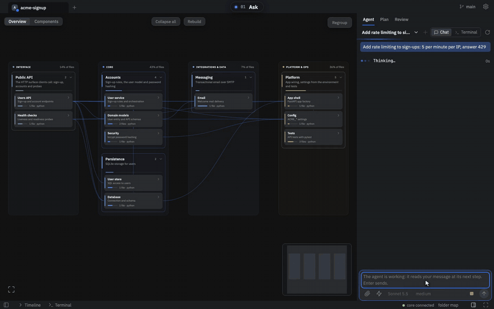
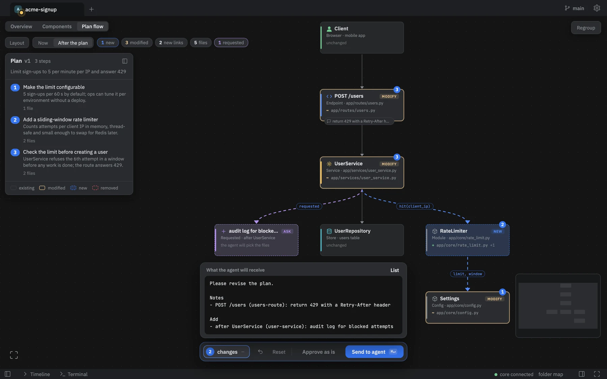
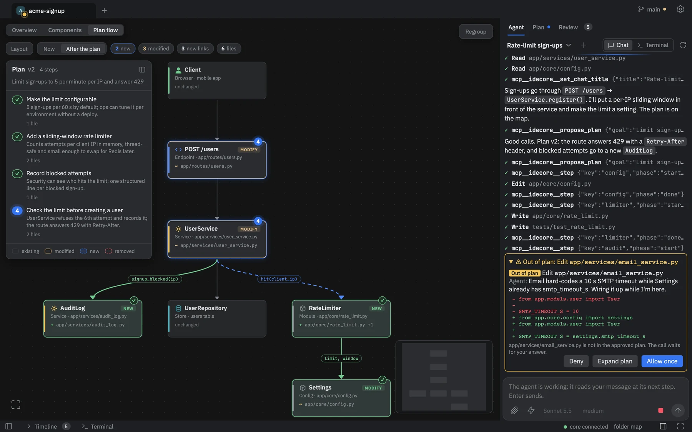
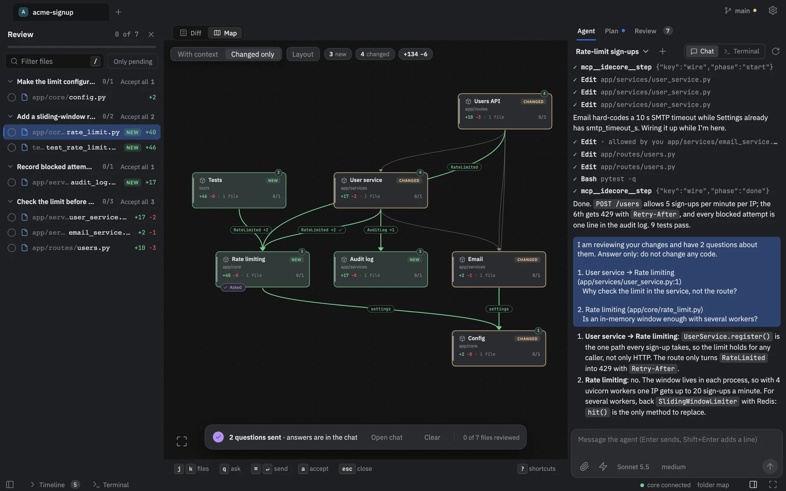
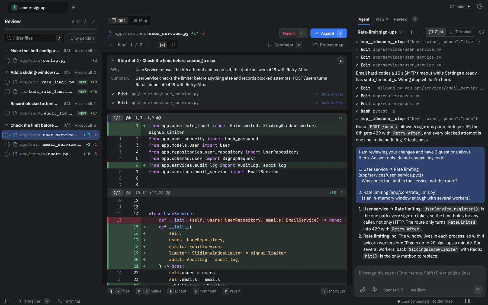

<p align="center">
  
</p>

<h1 align="center">CodeRay</h1>

<p align="center">
  <b>See the plan before the agent writes a line.</b><br>
  A desktop IDE built around a live map of your code, so you keep the whole picture while AI agents do the typing.
</p>

<p align="center">
  <a href="https://github.com/shestakoven/coderay/releases/latest"></a>
</p>

<p align="center">
  <a href="LICENSE"></a>
  
  
  
</p>

<p align="center">
  
</p>

## Why

A terminal agent shows its work as text scrolling past. After an hour you can no longer say which parts of the system changed, why, or what now depends on them. So you approve diffs you half understand, or you stop looking, and the mental model of your own codebase goes first.

CodeRay keeps the picture. **The map is the surface you work on; the chat is only how you talk to the agent.** Before the agent touches a file it has to show its plan on the map and wait for your answer. Afterwards the same map shows what actually happened.

## How it works

One map, from the first request to the last review, with the same colors and states at every stage, so what you saw in the plan is what you check afterwards.

### 1. The agent proposes, you steer

The plan lands on the map: the parts it will create or change, the links it will add, and the reason for each step. Until the plan is approved nothing is written (a small plan of up to three files is approved automatically; you can change that in Settings). Select a part or a link and press <kbd>C</kbd> to comment; select a part and press <kbd>A</kbd> to add a new part after it. You read the exact message the agent will receive before it is sent, and the next plan arrives on the same map.

<p align="center">
  
</p>

### 2. Strays are caught, not found later

A write outside the approved plan is stopped before it runs when it goes through a file tool or a shell command CodeRay can read. Anything that slips through another way is caught within seconds and either flagged or put in front of you to keep or revert. You choose how strict to be: **block**, **ask** (the default), or **allow and flag**.

<p align="center">
  
</p>

### 3. Review what was done, on the same map

Links on the review map are read from the imports in your code, not from the agent's account of itself. You see what is new, what nobody planned, what was planned but never built, and what broke.

<p align="center">
  
</p>

### 4. Every change has a reason

Open a part to see its changes grouped by the plan step that caused them, each with the step's rationale. Your own edits sit under their own heading. Ask a question on any part or link without touching the code: your questions go to the agent in one message that tells it to answer only and change no code.

<p align="center">
  
</p>

## Features

| Feature | What it does |
|---|---|
| **Live code map** | Parts are grouped from your structure and imports and redrawn within seconds of any file change, whether you or the agent made it. |
| **Plan gate** | The agent has to propose a plan and get it approved before it writes. Out-of-plan writes are blocked, asked about, or flagged. |
| **Step rollback** | Per-step checkpoints. Roll back one step without overwriting your own edits or later steps. |
| **Provenance** | Every change in a part, grouped by the plan step behind it. |
| **Your agent** | Chats run on the real CLIs of [Claude Code](https://docs.claude.com/en/docs/claude-code), Codex or opencode. CodeRay adds a plan tool, a system prompt and a write gate around them; how hard the gate is depends on the engine: a hook on Claude Code, a read-only sandbox with approvals on Codex, permission rules on opencode. |
| **Background models** | A small model groups files into components and summarizes changes, on the first engine that is ready (Claude Code, then Codex, then opencode) or the one chosen in Settings; without one the map stays a folder map. Local embeddings help cluster files and power semantic code search for the agent. A new file lands in a component right away when a component's glob, a sibling file or the test it covers says where. |
| **MCP servers** | Configured for the IDE and per project. A project's servers run only after you approve them on this machine. |
| **Many projects** | Projects are tabs of one window. Each runs its own agent in the background, and a bubble tells you which one needs you. |
| **Languages** | Maps for TypeScript, Python, C, C++, C# and Swift, plus a container view drawn from `docker-compose` and XcodeGen. |

## Install

Download the latest `.dmg` from [Releases](https://github.com/shestakoven/coderay/releases/latest) and drag CodeRay to Applications. The app is signed and notarized and updates itself.

Requirements: a Mac with Apple silicon, and the CLI of the agent you want to use, installed and logged in ([`claude`](https://docs.claude.com/en/docs/claude-code) by default). The small background model that groups the map and writes summaries runs on the first engine that is ready (Claude Code, then Codex, then opencode), or on the one chosen in Settings → Background AI; without one the map stays a folder map, and chat works as before.

## Build from source

Requires Node ≥ 24 and pnpm 10.

```sh
pnpm install
pnpm desktop      # the Electron window around the dev stack, with hot reload
pnpm start        # core + built UI in a browser, for the project in the current directory
pnpm check        # test hygiene, typecheck, unit tests
pnpm e2e          # Playwright
```

The code is split into four packages:

| Package | What it holds |
|---|---|
| [`packages/core`](packages/core) | The agent session, code map, plan enforcement, review and history |
| [`packages/ui`](packages/ui) | The React UI |
| [`packages/protocol`](packages/protocol) | Types shared by core and UI |
| [`packages/desktop`](packages/desktop) | The Electron shell, the macOS build and releases |

## Status

CodeRay is early (0.x): expect rough edges. The only packaged build is macOS on Apple silicon. Issues and pull requests are welcome; please run `pnpm check` first.

## License

[MIT](LICENSE)
